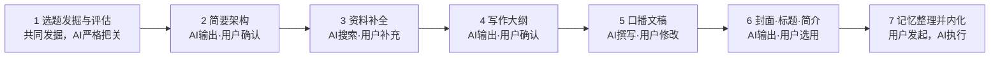

# 遊牧人Wayfarer · 频道创作手册 v1.0

## 快速导航

- [遊牧人Wayfarer · 频道创作手册 v1.0](#遊牧人wayfarer--频道创作手册-v10)
  - [快速导航](#快速导航)
  - [流程总览](#流程总览)
  - [流程启动判断](#流程启动判断)
  - [阶段 1：选题发掘与评估](#阶段-1选题发掘与评估)
  - [阶段 2：核心承诺设计](#阶段-2核心承诺设计)
  - [阶段 3：创作大纲](#阶段-3创作大纲)
  - [阶段 4：资料补全](#阶段-4资料补全)
  - [阶段 5：文稿创作](#阶段-5文稿创作)
  - [阶段 6：包装运营](#阶段-6包装运营)
    - [阶段6A：封面标题设计](#阶段6a封面标题设计)
    - [阶段6B：SEO优化](#阶段6bseo优化)
  - [附录 A：再创作专项流程](#附录-a再创作专项流程)
    - [再创作 vs 原创的流程差异](#再创作-vs-原创的流程差异)
    - [再创作增值检查（必须满足 ≥3 项）](#再创作增值检查必须满足-3-项)
    - [底线：洗稿 vs 再创作](#底线洗稿-vs-再创作)
  - [附录 B：文档索引](#附录-b文档索引)
  - [附录 C：单期影片 README 读取与修改规则](#附录-c单期影片-readme-读取与修改规则)
    - [C1. 适用范围与事实源](#c1-适用范围与事实源)
    - [C2. 读取规则](#c2-读取规则)
    - [C3. 初始化真实项目](#c3-初始化真实项目)
    - [C4. 创作阶段与确认修改](#c4-创作阶段与确认修改)
    - [C5. 发布、数据与分析修改](#c5-发布数据与分析修改)
    - [C6. 同步与文档索引](#c6-同步与文档索引)
    - [C7. 归档与记忆整理](#c7-归档与记忆整理)
  - [附录 D：Skills 说明](#附录-dskills-说明)
    - [`archive-episode`](#archive-episode)
    - [`episode-memory-sync`](#episode-memory-sync)
    - [`creative-memory-sync`](#creative-memory-sync)
    - [`channel-decision-sync`](#channel-decision-sync)

---

## 流程总览

**节奏**：一周两更。

---

## 流程启动判断

- **原创选题**（用户自己的灵感/痛点）：直接进入阶段1
- **再创作**（基于他人内容）：先执行【附录A：再创作专项流程】，通过增值检查后再进入阶段1

---

## 阶段 1：选题发掘与评估

**负责人**：共同
**执行方式**：激活 `topic-discovery` Skill
**再创作判断**：如用户提供他人内容链接或明确说"基于XXX做一期"，先执行附录A

**阶段目标**：
- 用户提供初步想法、内容素材、链接或方向
- AI 协助锐化选题方向，直到可以用一句话说清楚
- AI 使用三维门槛（痛点强度 + 科学锚点 + 差异化）严格评估
- AI 进行受众命中检查和观众点击测试
- 用户确认评估简报后，方可进入下一阶段

**核心原则**：
- 宁可拒绝100个平庸选题，也绝不让1个模式化选题通过评估
- 模式化选题 = 套用”现象→原理→方法”就能讲，但没有独特洞察
- 所有评估必须提供具体证据，不能只勾选”通过”

**三维门槛**：
1. **痛点强度**：必须描述具体场景（精确到人群、时间、地点、具体问题），不能用宽泛表述
2. **科学锚点**：必须用三句话拆解（因果机制 + 与痛点的关系 + 反常识结论）
3. **差异化**：必须识别YouTube上该话题的2种常规打法，说明我们的结构性差异

**观众点击测试**：
- 搜索场景：观众在什么情境下会主动搜索？
- 点击触发：为什么会点我们而不是其他视频？
- 竞争优势：我们的独特吸引力是什么？

**防偷懒机制**：
- AI必须完成“完成度测试”（模式化自查 + 深度自查 + 证明自查）
- 文件中包含大量反面案例，标明“绝对禁止”的空洞表述

> [!NOTE]
> 完整的评估标准、测试方法与反面案例请见：[.agents/skills/topic-discovery/SKILL.md](.agents/skills/topic-discovery/SKILL.md)

---

## 阶段 2：核心承诺设计

**负责人**：共同
**执行方式**：激活 `core-promise-design` Skill

**阶段目标**：
- 提炼这期视频的”一句话承诺”（20-50字）
- 确定承诺类型（认知颠覆型、快速工具型、深度揭秘型、案例拆解型等）
- 确定标题方向（不是最终标题，是大致方向）
- 设计兑现路径（内容重点、观众收获、避免陷阱）
- 用户确认后，方可进入下一阶段

**核心原则**：
- 观众看完视频后会用一句话描述它，这句话就是核心承诺
- 标题方向必须与内容重点一致，避免”标题党”
- 本阶段确定的承诺类型和标题方向，是阶段6（封面标题设计）的强制约束

**四种承诺类型**（包含但不限于）：
1. **认知颠覆型**：打破旧认知，提供反常识理解（”停止XXX””别再XXX”）
2. **快速工具型**：提供立刻可用的具体方法（”X分钟XXX法”）
3. **深度揭秘型**：揭示底层机制，满足好奇心（”为什么XXX””揭秘XXX”）
4. **案例拆解型**：从具体人物/事件提取可复用系统（”名人的XXX法”）

**兑现路径设计**：
- 内容重点：篇幅分配（用百分比）
- 观众收获：认知层 + 行动层
- 避免陷阱：哪些内容必须克制

> [!NOTE]
> 完整的承诺类型、标题方向关键词与反面案例请见：[.agents/skills/core-promise-design/SKILL.md](.agents/skills/core-promise-design/SKILL.md)

---

## 阶段 3：创作大纲

**负责人**：共同
**执行方式**：激活 `outline-creation` Skill

**阶段目标**：
- 设计观众的完整旅程（不是给自己看的目录，是给观众设计的体验路径）
- 确定叙事结构（观众体验顺序，可能不同于逻辑顺序）
- 设计观众情绪曲线（按视频百分比，不固定时长）
- 标出退出点并设计预防机制（3个最可能退出的时间点）
- 输出分段施工图（每段包含：观众状态转变、内容设计、挂载资料、记忆锚点、过渡设计）
- 用户确认后，方可进入下一阶段

**核心原则（三管齐下）**：
1. **管住注意力**：每个段落必须有推进，拒绝原地踏步
2. **管住理解**：科学内容必须翻译成生活语言
3. **管住行动**：行动方案必须是”今天就能做”的微小动作和可落地方法

**叙事结构根据承诺类型**：
- 认知颠覆型：先打破，再重建
- 快速工具型：先给方法，再讲原理
- 深度揭秘型：先制造好奇，再层层揭开
- 案例拆解型：先讲故事，再提取系统

**资料内嵌规则**：
- 每个段落的”挂载资料”直接给出具体资料（来自AI知识库）
- 标注来源类型：`[知识库]` / `[需搜索]` / `[用户补充]`
- 不要写”需要找一个案例”这种模糊需求

> [!NOTE]
> 完整的叙事结构设计、情绪曲线、分段施工图模板请见：[.agents/skills/outline-creation/SKILL.md](.agents/skills/outline-creation/SKILL.md)

---

## 阶段 4：资料补全

**负责人**：共同
**执行方式**：激活 `material-enrichment` Skill

**阶段目标**：
- 读取阶段3创作大纲，识别资料补全任务
- 对标注为`[需搜索]`的资料，执行联网搜索
- 接收用户补充的资料，评估并整合
- 验证阶段3中标注为`[知识库]`的关键数据和实验
- 对所有资料进行质量评估（权威性、时效性、相关性）
- 输出最终资料清单和补全报告

**核心原则**：
- 这是补充性阶段，阶段3已内嵌大部分资料，这里只处理缺口
- 搜索必须真实执行，不能从知识库拿”差不多”的资料替代
- 用户补充的资料需评估价值，不能无脑接受或拒绝
- 关键数据必须验证准确性，不能”大概觉得对”

**快速通过机制**：
- 如果无搜索任务、无用户补充、无验证需求，可快速通过
- 输出”快速通过”确认后，直接进入阶段5

**三类资料质量评估**：
1. **科学锚点资料**：权威性、时效性、相关性
2. **案例资料**：具体性、共鸣度、可信度
3. **数据资料**：冲击力、准确性、相关性

> [!NOTE]
> 完整的搜索标准、验证方法、质量评估维度请见：[.agents/skills/material-enrichment/SKILL.md](.agents/skills/material-enrichment/SKILL.md)

---

## 阶段 5：文稿创作

**负责人**：共同
**执行方式**：激活 `script-writing` Skill

**阶段目标**：
- 将创作大纲转化为可直接录制的口播文稿
- 逐段写作 + 即时自检（不要一次写完全部）
- 完成四项质量测试（朗读卡顿、信息密度、反AI腔、金句对标）
- 输出完整文稿 + 创作报告
- 用户确认后，方可进入下一阶段

**核心原则**：写出的文稿必须是”人在说话”，不是”AI在写作文”

**三层写作规范**：

1. **硬约束（必须遵守）**：
   - 人称规则：默认”你”，共情时”我们”，验证时”我”（自然流动，不机械切换）
   - 禁区清单：禁止指责受众、空洞鸡汤、大段复述原文
   - 行动标准：今天就能做、有完成标准、门槛低

2. **软引导（灵活掌握）**：
   - 术语翻译：白话定义（必须）→ 场景类比（可选）→ 重铸别名（谨慎）
   - 节奏控制：自然表达，句子长短服从表达需要，不刻意追求短句
   - 开场收束：形式灵活（反常识、微观场景、开门见山、直奔主题、极端案例、悬念、打假……）

3. **质量检验（写完必测）**：
   - **朗读卡顿测试**：标出所有卡顿句，重写到流畅
   - **信息密度测试**：有效信息句≥80%，删除重复表述
   - **反AI腔测试**：删除”那么””所以””首先””非常””极其””颠覆”等高频AI表达
   - **金句对标测试**：关键句表达自然、直接肯定，不刻意追求固定长度

**金句语料库特征**（作为”音叉”校准）：
- 长度：15-25字（参考范围，不是硬性要求）
- 结构：判断句为主，少用感叹号
- 温度：直接、肯定，不拐弯抹角
- 节奏：根据表达需要自然变化，不刻意追求短句

**防偷懒机制**：
- 逐段写作 + 段落即时自检（新信息、状态转变、资料挂载、记忆锚点）
- 禁止”扩写大纲”（把大纲每句话变成三句话）
- 写作难点记录（供未来优化）

> [!NOTE]
> 完整的写作规范、金句语料库、四项测试标准、反面案例请见：[.agents/skills/script-writing/SKILL.md](.agents/skills/script-writing/SKILL.md)

---

## 阶段 6：包装运营

**负责人**：共同
**执行方式**：激活 `episode-packaging` Skill

**阶段分为两个子阶段**：
- **6A：封面标题设计**（CTR引擎）
- **6B：SEO优化**（搜索权重引擎）

---

### 阶段6A：封面标题设计

**阶段目标**：
- 严格读取阶段2的承诺契约（承诺类型、标题方向、兑现路径）
- 检查文稿是否兑现了阶段2的承诺
- 输出3组”封面文字+视频标题”方案（繁体中文）
- 每组方案必须有结构性差异（信息侧重、情绪触发、表达风格）
- 用户选定一组后，进入6B

**核心原则**：标题承诺必须与文稿内容一致，适度夸张吸引点击，但绝不越界

**标题党底线（三级分类）**：
1. **✓ 绿灯区（可以用）**：放大真实价值
   - 文稿确实讲了，只是用更吸睛的方式表达
   - 观众看完会觉得”标题夸张了，但确实学到了”
2. **⚠️ 黄灯区（谨慎使用）**：情绪化表达
   - 用强烈情绪词，但不改变核心事实
   - 夸张的数据/比例，文稿必须有支撑
3. **✗ 红灯区（绝对禁止）**：承诺文稿没有的东西
   - 标题承诺的内容，文稿必须占≥50%篇幅

**承诺类型对应的标题公式**：
- 认知颠覆型：停止XXX / 别再XXX / XXX是错的
- 快速工具型：X分钟XXX法 / 一招XXX / 只需XXX
- 深度揭秘型：为什么XXX / XXX的真相 / 揭秘XXX
- 案例拆解型：名人的XXX法 / 拆解XXX系统

**封面文字与标题关系**（不是复读）：
- 补充信息、制造悬念、强化对比、突出数据

---

### 阶段6B：SEO优化

**阶段目标**：
- 基于用户选定的标题，设计视频简介（繁体，200-400字）
- 设计关键词（四层布局，总数15-20个）
- 确保关键词自然嵌入标题、简介前3行

**简介结构**：
1. 悬念前置（1-2句，制造好奇）
2. 核心观点（2-3句，对应阶段2承诺）
3. 价值承诺（1-2句，对应阶段5行动方案）
**简介结构**：
1. 悬念前置（1-2句，制造好奇）
2. 核心观点（2-3句，对应阶段2承诺）
3. 价值承诺（1-2句，对应阶段5行动方案）
4. 行动号召（1句，引导互动）
5. 频道信息

**注意**：不使用时间戳

**关键词五层布局**（总数18-25个）：
1. **核心标签词**（2-3个）：學習方法、認知科學、大腦科學
   - 每期必有，强化频道定位
2. **精准长尾词**（5-7个）：為什麼背了就忘、如何快速記憶、背書技巧
   - 按选题场景选择，必须在文稿中被讨论
3. **受众分层词**（3-5个）：孩子學習方法、上班族學習方法、學習誤區
   - 按目标受众选择
4. **流量词**（0-2个）：自我提升、個人成長
   - 谨慎使用，避免稀释频道标签
5. **英文关键词**（3-5个）：learning methods, active recall, study tips
   - 扩大国际受众

**输出格式**：分层展示 + 可直接复制的逗号分隔格式

> [!NOTE]
> 完整的标题公式、封面设计、标题党底线、关键词库请见：[.agents/skills/episode-packaging/SKILL.md](.agents/skills/episode-packaging/SKILL.md)

---

## 附录 A：再创作专项流程

> 基于其他博主/创作者的内容，经过频道滤镜重新输出。**不是洗稿**。

**核心原则**：再创作不是洗稿，而是用频道的独特视角重新解读已有内容，创造新的价值。

---

### 再创作 vs 原创的流程差异

| 阶段 | 原创 | 再创作 |
|------|------|--------|
| **阶段0** | 无 | **原始内容分析**（新增阶段：记录来源、拆解结构、识别可用角度） |
| **阶段1** | 从痛点出发 | 从他人内容出发，进行**再创作增值检查**（必须满足≥3项） |
| **阶段2** | 常规 | 常规，但必须确保承诺与原作不同 |
| **阶段3** | 常规 | 常规，但叙事结构必须与原作不同 |
| **阶段4** | 搜索补全 | 原始内容拆解 + 额外资料补全（至少50%资料是我们补充的） |
| **阶段5** | 常规 | 常规 |
| **阶段6** | 常规 | **在参考资料中标注原始来源**（灵感来源部分） |

---

### 再创作增值检查（必须满足 ≥3 项）

在进入正式6阶段流程前，必须通过以下检查：

- [ ] **重新定义问题**：用我们的受众痛点重新框定主题
  - ✗ 原作：如何提高记忆力
  - ✓ 我们：为什么重复阅读记不住？

- [ ] **补充/替换科学锚点**：加入原作未提及的脑科学/认知科学/心理学原理
  - ✗ 原作：提到"提取练习效应"
  - ✓ 我们：深入讲解海马体记忆重写机制 + 实验详细数据

- [ ] **翻译为我们的体系**：用频道的语言体系重新包装
  - ✗ 原作：费曼学习法
  - ✓ 我们：费曼学习法2.0/白纸记忆法

- [ ] **增加行动方案**：给出原作没有的具体微小行动
  - ✗ 原作：要多回忆
  - ✓ 我们：合上书，在白纸上写出三个核心要点

- [ ] **切换受众视角**：从我们三个核心受众的角度重新组织内容
  - ✗ 原作：面向学生
  - ✓ 我们：面向职场人，切换到"上班族如何快速学习新技能"

---

### 底线：洗稿 vs 再创作

**❌ 洗稿特征（绝对禁止）**：
- 结构几乎一致（叙事顺序完全一样）
- 观点完全一致（原作的每个观点我们都有，没有任何新观点）
- 资料高度重复（90%以上来自原作，只是换个说法）

**✓ 合格再创作特征（必须满足）**：
- 结构不同（叙事顺序改变）
- 观点有增量（新增观点占比≥40%）
- 资料有补充（至少50%是我们补充的）
- 明确标注来源

> [!NOTE]
> 完整的原始内容分析、增值检查标准、底线判断、反面案例请见：[.agents/skills/recreation-framework/SKILL.md](.agents/skills/recreation-framework/SKILL.md)

---

## 附录 B：文档索引

- [Wayfarer2.0](./)：频道创作工作区
  - [AGENTS.md](./AGENTS.md)：频道创作流程、内容规范与协作约定
  - [.agents/skills/](./.agents/skills/)：项目级 Skills
    - [archive-episode/](./.agents/skills/archive-episode/)：归档单期项目并启动记忆整理
    - [episode-memory-sync/](./.agents/skills/episode-memory-sync/)：同步往期影片事实与索引
    - [creative-memory-sync/](./.agents/skills/creative-memory-sync/)：整理大纲与文稿经验
    - [channel-decision-sync/](./.agents/skills/channel-decision-sync/)：整理频道重大决策并完成最终审计
  - [memories/](./memories/)：跨期创作记忆
    - [大纲创作技巧记忆.md](./memories/大纲创作技巧记忆.md)：跨期大纲创作技巧记录
    - [往期影片信息记录.md](./memories/往期影片信息记录.md)：跨期影片索引、圈层配额、经验与待验证动作
    - [文稿撰写记忆.md](./memories/文稿撰写记忆.md)：跨期文稿撰写技巧记录
    - [重大决策记忆.md](./memories/重大决策记忆.md)：跨期重大决策记录
  - [project/](./project/)：单期影片项目目录（按约定不在本索引展开）
  - [WritingStyle/](./WritingStyle/)：频道写作风格与历史样稿
    - [raw/](./WritingStyle/raw/)：历史影片的标题、封面文案、表现数据与逐字稿
      - [2分钟告别拖延.md](./WritingStyle/raw/2分钟告别拖延.md)：《2分钟告别拖延》逐字稿与表现数据
      - [成瘾式学习法.md](./WritingStyle/raw/成瘾式学习法.md)：《成瘾式学习法》逐字稿
      - [大脑喜欢这样学.md](./WritingStyle/raw/大脑喜欢这样学.md)：《大脑喜欢这样学》逐字稿
      - [简单3步吃透1本书.md](./WritingStyle/raw/简单3步吃透1本书.md)：《简单3步吃透1本书》逐字稿
      - [拖延没动力.md](./WritingStyle/raw/拖延没动力.md)：《拖延没动力》逐字稿
      - [西蒙学习法.md](./WritingStyle/raw/西蒙学习法.md)：《西蒙学习法》逐字稿
    - [WritingStyle.md](./WritingStyle/WritingStyle.md)：频道口播文稿的声音画像、结构与写作校验规范

---

## 附录 C：单期影片 README 读取与修改规则

### C1. 适用范围与事实源

- `project/example/README.md` 是**单期影片记录模板**，只用于初始化新影片项目；不得把模板中的占位值、示例路径或默认状态当作真实影片事实。
- 真实单期影片的唯一事实源是 `project/<episode>/README.md`。标题、发布状态、数据和分析发生冲突时，以该文件为准。
- 跨期记忆只能从已确认的真实单期 README 提炼；不得用 `memories/` 中的内容反向覆盖、补全或推断单期 README。
- README 的 Changelog 是已确认决策与重要变更的持久记录；聊天内容必须先进入 Changelog，才能作为大纲、文稿或重大决策记忆的依据。

### C2. 读取规则

- 读取真实单期 README 时，先确认 `episode_id`、当前状态和“创作确认”表，再读取与当前工作阶段直接相关的章节。
- 整理记忆时还必须读取 Changelog 及其中明确指向的本期最终文件；Git 只能证明发生了修改，不能用于推断修改原因。
- 将空字段、`—`、`暂无可核验数据`、`未进行`视为**尚无事实或尚未确认**，不得根据上下文、旧记忆或常识擅自补全。
- 结论、表现等级和可复用经验必须能回溯到“数据记录”或明确证据；无法回溯时，按“待验证”或“无法判断”处理。
- 再创作项目需要在本期资料中保留原始来源；未记录来源时，不得将其描述为已完成的再创作资料。

### C3. 初始化真实项目

- 创建真实单期项目时，从 `project/example/README.md` 复制章节结构；删除模板说明和所有占位提示后，再填写已知事实。
- 创建时生成 `episode_id`，格式为 `WF-YYYYMMDD-NN`；创建后不得因标题、目录名或发布日期变化而修改。
- `创建日期`使用项目初始化日期，格式为 `YYYY-MM-DD`；`选题`必须同时表达主题与切入角度，避免同题不同写法混淆。
- `受众圈层`只能填写“第一圈”“第二圈”或“第三圈”；`内容类型`只能填写“原创”或“再创作”。
- 保留所有模板章节、确认节点、数据字段和文档索引。未知信息保持为空或使用模板规定的默认值，不删除字段来隐藏缺失信息。
- 保留 Changelog 的固定表头；第一条真实记录写入时删除“暂无已确认记录”占位行。

### C4. 创作阶段与确认修改

- `当前状态`只能填写“选题评估”“简要架构”“资料补全”“写作大纲”“口播文稿”“封面·标题·简介”或“归档”。
- 仅在用户作出明确确认后，才能修改“当前状态”与“创作确认”表对应行；不得把草稿完成、口头讨论或推测视为确认。
- 每次确认应同步填写确认日期、决策摘要和必要备注；影片取消或暂停时，未进行的节点必须保留，不得伪造为已确认。
- “归档”行仅能在用户明确确认归档后标记为“已确认”。
- Changelog 只记录已确认且会影响本期结果或以后创作的决策、重要变更、明确否决和记忆写入；不得记录细小编辑、工具过程或 AI 推测。

### C5. 发布、数据与分析修改

- 归档时填写“发布结果”。归档结果只能为“已发布”“未发布”“取消”或“暂停”。
- 归档结果为“已发布”时，必须填写最终标题、发布平台、视频链接、发布时间和视频时长；发布时间格式为 `YYYY-MM-DD HH:mm`，时长格式为 `HH:MM:SS` 或 `MM:SS`。
- 归档结果为“未发布”“取消”或“暂停”时，必须填写终局原因和下一次复核动作。
- 每条原始数据必须包含采集日期、统计周期、来源、平台、指标和数值。没有可核验数据时保留“暂无可核验数据”，不得填写模拟值。
- 数据分析只在“数据记录”或明确证据基础上修改；结论状态只能为“已验证”“待验证”“失败”或“无法判断”。仅“已验证”与“失败”可以填写可复用经验，仅“待验证”可以填写待验证假设。

### C6. 同步与文档索引

- 将真实单期 README 同步到跨期记忆前，每个负责写入的 Skill 都必须先用直白语言说明准备记录的内容和依据，并取得一次明确批准；批准后立即写入、回读检查，再进入下一步。
- 发生文件结构变化时，同步更新该单期 README 的“文档索引”，逐项列出真实文件路径及其用途。
- `project/example/README.md` 始终只作为模板保留，不记录真实影片数据，也不参与跨期记忆同步。

### C7. 归档与记忆整理

- 用户明确表达“本期正式归档，并开始整理记忆”的同等含义时，触发 `archive-episode`；不要求固定标点或逐字一致。
- 触发语授权完成本期 README 归档，但不直接授权写入 `memories/`。四份记忆必须全部审计，并由各自 Skill 单独询问。
- 固定顺序为：`archive-episode` → `episode-memory-sync` → `creative-memory-sync` → `channel-decision-sync` → 最终审计。
- Skills 之间使用内部交接指令；面向用户只说明当前准备记录什么、依据是什么以及是否继续，不显示技术术语。当前只有一个待确认问题时，`Y`、`是`或`继续`可视为明确批准。
- 没有新增内容时不修改对应文件，但仍继续审计下一份记忆；写入或回读检查失败时停止，从失败步骤恢复，不撤销此前已批准且检查通过的结果。
- 单次修改只作为待观察；同一模式由三个不同项目支持后，才可询问是否升级为长期规则。重大决策只能来自用户明确决定，不得从单期表现自动推断。
- 例行归档只修改本期直接影响的条目和必要统计；与本期无关的历史问题只报告，不顺手重写。
- 四份记忆全部审计后，必须再次询问用户是否确认整体完成且允许保存版本记录；得到明确批准前不得提交 Git。

---

## 附录 D：Skills 说明

四个 Skills 共同组成单期归档与记忆整理流程。每个 Skill 只拥有明确的主要写入目标，并通过本期 README Changelog 保留来源。

### `archive-episode`

- **用途**：归档当前唯一的真实单期项目，并启动逐步记忆整理。
- **触发**：用户明确表达本期正式归档且开始整理记忆，或显式调用该 Skill。
- **写入边界**：只修改本期 README；触发语本身已经授权归档，不修改 `memories/`。
- **完成标准**：归档事实完整、Changelog 可追溯、只读检查通过，并已询问是否进入往期影片记录整理。
- **详细规则**：[`.agents/skills/archive-episode/SKILL.md`](./.agents/skills/archive-episode/SKILL.md)。

### `episode-memory-sync`

- **用途**：将单期影片 README 中已确认、可复核的事实投影为跨期决策索引，支持归档影片、补充已发布数据、修正跨期结论和审计长期记忆一致性。
- **事实源与产物**：以 `project/<episode>/README.md` 为唯一事实源，将摘要写入 `memories/往期影片信息记录.md`。`project/example/README.md` 仅是模板，不能作为同步来源。
- **何时使用**：在归档串联流程中接收上一步交接，或用户明确要求预览、同步、刷新或审计往期影片记录时运行。
- **执行方式**：先只读校验并说明准备记录的内容；取得本步批准后写入、回读校验，并向本期 Changelog 追加一条成功记录。
- **边界**：主要只写往期影片记忆；除成功写入日志外不反向修改单期 README，不修改逐字稿、素材或原始数据。
- **完成标准**：每个 `episode_id` 在长期记忆中仅保留一条、回链真实 README，且权威字段、指标标签和最近十期圈层配额均通过校验。
- **详细规则**：[`.agents/skills/episode-memory-sync/SKILL.md`](./.agents/skills/episode-memory-sync/SKILL.md)。

### `creative-memory-sync`

- **用途**：从本期 Changelog 与最终文件提炼大纲技巧、文稿经验和表达偏好。
- **写入目标**：`memories/大纲创作技巧记忆.md` 与 `memories/文稿撰写记忆.md`。
- **证据门槛**：明确长期要求可直接成为候选；单期修改只待观察；三个不同项目重复后才可提议升级。
- **边界**：不得仅凭聊天、无原因的 Git 变化或播放数据推断永久写作规则。
- **详细规则**：[`.agents/skills/creative-memory-sync/SKILL.md`](./.agents/skills/creative-memory-sync/SKILL.md)。

### `channel-decision-sync`

- **用途**：同步用户明确作出的频道长期决定，并完成四份记忆最终审计。
- **写入目标**：`memories/重大决策记忆.md`；没有新决定时保持文件不变。
- **证据门槛**：决定必须由用户明确作出并已进入本期 Changelog，可以先记录、后验证。
- **边界**：不得从单期表现、一次修改或 agent 建议自动生成战略决策；最终审计不顺手重写无关历史。
- **详细规则**：[`.agents/skills/channel-decision-sync/SKILL.md`](./.agents/skills/channel-decision-sync/SKILL.md)。
