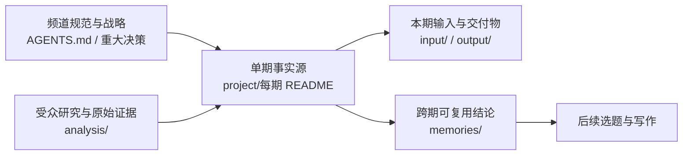

# 遊牧人 Wayfarer 2.0

这是「遊牧人 Wayfarer」频道的创作工作区。它把选题、研究、逐字稿、发布物料、复盘数据和可复用经验保存在同一个可追溯的版本库中，服务于持续产出学习方法、个人生产力与认知成长内容。

本仓库主要由 Markdown 与 JSON 资料组成，不是需要安装依赖、编译或部署的软件项目。

## 项目定位

频道以「脑科学 + 学习效率 + 认知黑客」为核心，通过同心圆扩展内容边界：

| 圈层 | 内容重点 | 典型问题 |
| --- | --- | --- |
| 第一圈 | 微观学习方法 | 怎样记忆、学习、阅读和启动行动？ |
| 第二圈 | 个人生产力与精力管理 | 怎样在有限时间和精力中稳定完成事情？ |
| 第三圈 | 认知决策与心智模式 | 怎样在复杂处境中更清醒地思考和选择？ |

核心受众包括为孩子寻找学习方法的成年人、时间碎片化的职场终身学习者，以及希望恢复行动感与掌控感的中年观众。

## 工作区如何运作

这张图有一个重要边界：`memories/` 是已确认结论的摘要，不会反向覆盖单期项目。某一期的标题、状态、发布数据和 Changelog 均以该期 `README.md` 为唯一事实源。

## 当前项目状态

下表根据各真实单期项目的 `README.md` 整理，状态截至 2026-08-16。`project/example/` 仅是模板，不计入实际项目。

| episode_id | 单期项目 | 圈层 | 类型 | 当前状态 |
| --- | --- | --- | --- | --- |
| WF-20260803-01 | [费曼学习法：快速掌握新知识](./project/费曼学习法快速掌握新知识/README.md) | 第一圈 | 原创 | 归档 |
| WF-20260808-01 | [白纸记忆法（提取练习）](./project/WF-20260808-01/README.md) | 第一圈 | 再创作 | 归档 |
| WF-20260810-01 | [不靠自律十秒终结拖延症](./project/不靠自律十秒终结拖延症/README.md) | 第二圈 | 再创作 | 封面·标题·简介 |
| WF-20260814-01 | [记忆大师的 10 倍速学习法](./project/10倍速学习/README.md) | 第一圈 | 再创作 | 口播文稿 |

单期目录目前同时存在“标题命名”和“`episode_id` 命名”两种形式。因此，检索、引用和长期记忆同步时应始终使用 `episode_id`，不要仅依赖目录名。

## 目录导航

| 路径 | 职责 | 从这里开始的场景 |
| --- | --- | --- |
| [AGENTS.md](./AGENTS.md) | 频道创作手册、阶段流程、协作规则和单期 README 约束 | 开始新选题或不确定某条规则时 |
| [project/](./project/) | 单期影片项目；每期 README 是事实源 | 查询某一期状态、资料、文稿与数据 |
| [project/example/README.md](./project/example/README.md) | 新建单期项目的 README 模板 | 初始化新一期时 |
| [WritingStyle/WritingStyle.md](./WritingStyle/WritingStyle.md) | 频道声音画像、结构、语言细则与自检清单 | 写大纲、逐字稿或审稿时 |
| [WritingStyle/raw/](./WritingStyle/raw/) | 历史影片逐字稿与表现资料 | 对齐频道既有表达和案例密度时 |
| [analysis/wayfarer_audience/](./analysis/wayfarer_audience/) | 观众任务、注意力时间线、增长机制与相邻方向研究 | 做选题判断或复盘受众需求时 |
| [memories/](./memories/) | 跨期已确认经验、影片索引与频道级决策 | 规划新一期前提取可复用约束时 |
| [.agents/skills/](./.agents/skills/) | 归档、记忆同步与文字质量相关的项目级 Skill | 执行已定义的专项流程时 |
| [.obsidian/](./.obsidian/) | Obsidian 本地工作区配置 | 在 Obsidian 中浏览本库时 |

## 单期创作流程

每一期按以下顺序推进；阶段产出必须经过用户确认后，才可以更新该期 README 中对应的状态与确认记录。

1. 选题发掘：明确观众痛点、来源素材与所属圈层。
2. 选题评估：检查痛点强度、科学锚点、行动空间、圈层匹配与差异化。
3. 简要架构：确定核心问句、核心承诺、逻辑链条和预估字数。
4. 资料补全：整理研究、书籍或访谈为可引用的资料卡片。
5. 写作大纲：选择合适的叙事结构，并设计钩子、解释、行动与收束。
6. 口播文稿：产出可直接提词录制的逐字稿，并依据写作规范自检。
7. 封面、标题、简介与关键词：形成发布物料。
8. 归档与记忆整理：在用户明确确认归档后，记录发布结果、数据与可复用结论。

完整的字段要求、再创作增值标准和确认规则见 [AGENTS.md](./AGENTS.md)。

## 新建一期的最小步骤

1. 在 `project/` 下创建本期目录，并以 [单期模板](./project/example/README.md) 初始化 README 的章节结构。
2. 生成不可变的 `episode_id`，格式为 `WF-YYYYMMDD-NN`；填写创建日期、选题、圈层和内容类型。
3. 将本期资料放入该目录，并在单期 README 的“文档索引”中登记真实路径和用途。
4. 按创作流程推进。只有在明确确认后，更新“当前状态”“创作确认”表和 Changelog。
5. 发布或取消后，补全发布结果、原始数据与分析结论；没有可核验数据时保持“暂无可核验数据”。

## 事实与资料的优先级

| 需要回答的问题 | 应查看的位置 | 不应据此直接下结论的资料 |
| --- | --- | --- |
| 某一期现在做到哪里、是否发布、数据如何？ | `project/<episode>/README.md` | 模板、跨期记忆、聊天记录 |
| 写作时应遵守什么声音与结构？ | `WritingStyle/WritingStyle.md` 与已确认的记忆条目 | 单次草稿或未确认的建议 |
| 频道长期方向和比例是什么？ | `memories/重大决策记忆.md` | 单期表现或待确认的分析建议 |
| 观众研究的证据与限制是什么？ | `analysis/wayfarer_audience/` 的阶段报告及其原始数据 | 单个评论、未经验证的推断 |

`analysis/wayfarer_audience/` 中的相邻方向路线是决策支持材料。其中尚待用户确认的建议不能自动升级为频道长期策略。

## 归档与记忆边界

归档不是简单把文件放到历史目录，而是把本期已确认事实固化下来。归档后可按顺序使用以下专项流程：

1. [archive-episode](./.agents/skills/archive-episode/SKILL.md)：归档当前单期，并检查归档事实与 Changelog。
2. [episode-memory-sync](./.agents/skills/episode-memory-sync/SKILL.md)：同步影片索引与可核验的跨期数据。
3. [creative-memory-sync](./.agents/skills/creative-memory-sync/SKILL.md)：审计并预览可沉淀的大纲与文稿经验。
4. [channel-decision-sync](./.agents/skills/channel-decision-sync/SKILL.md)：仅同步用户明确作出的频道级长期决定，并完成最终审计。

每一步涉及长期记忆写入时，都必须先展示准备记录的内容和依据，并取得明确批准。

## 维护约定

- 不把 `project/example/README.md` 的占位内容当作真实影片资料。
- 不用跨期记忆补全、覆盖或猜测单期事实。
- 不把正在制作中的文稿、未发布物料或待验证分析表述为最终成果。
- 修改目录结构时，同步更新受影响单期 README 的“文档索引”。
- 每次实际修改完成后，先完成检查并等待用户确认；获得明确批准后再创建 Git 提交。

## 本次 README 建档范围

本文件根据工作区中现有的单期 README、频道手册、写作规范、跨期记忆和受众分析资料编写。它只提供入口、导航与边界说明，不改写任何历史结论，也不替代各单期项目的事实记录。
