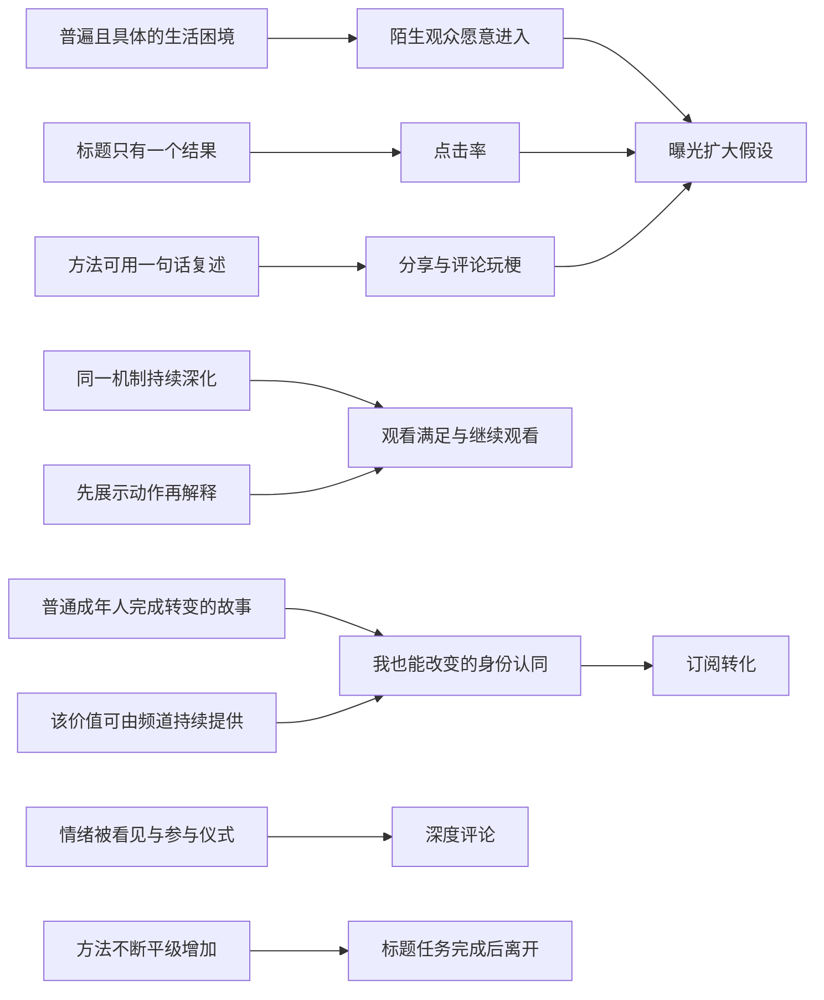

# Wayfarer进阶分析：阶段二注意力时间线与增长机制

> 分析日期：2026-07-14  
> 核心任务已确认：成年人仍然可以学会新东西。  
> 辅助任务：跨过启动阻力；让知识记得住、用得出。  
> 固定交付标准：一个核心模型、一个可执行动作。

## 一、方法与限制

六篇本地逐字稿按实际视频时长换算为约30秒一个区段，原始切分保存在 `attention_segments.raw.json`。时间点由逐字稿字符占比估算，不是YouTube官方字幕时间码。

平均观看时长由“总观看小时 ÷ 观看次数”计算；估算观看比例再除以实际片长。它只能说明平均观看位置，不能证明某一分钟存在留存断崖。

`拖延没动力`存在版本冲突：本地稿明确写三步，公开视频标题和高赞评论总结的是四步，说明成片可能使用了另一版文稿。因此该片的方法时间线只代表本地稿，不能与成片留存做精确对应。

分析使用六项统一尺度：

- **契约建立**：观众何时知道影片到底要回答什么。
- **首个可执行动作**：观众何时第一次得到可以立即尝试的动作。
- **承诺完整兑现**：标题承诺的方法何时讲完。
- **注意力负债**：首个动作之前需要听多少解释、权威和术语。
- **主线分叉**：影片是否从一个问题不断开启新的问题。
- **身份价值**：内容是否让观众相信“我仍然可以学习、行动和改变”。

---

## 二、六篇总对照

| 影片 | 平均观看 / 比例 | 每千次订阅 | 首个可执行动作 | 标题承诺讲完 | 主线分叉 | 可复述动作 |
|---|---:|---:|---:|---:|---:|---:|
| 2分钟告别拖延 | 3:07 / 35.8% | 9.0 | 3:43 | 约4:44 | 2 | 1个 |
| 大脑喜欢这样学 | 4:09 / 31.6% | 17.3 | 约2:40 | 标题过宽，约12:24 | 5 | 8个以上 |
| 成瘾式学习法 | 3:04 / 28.1% | 13.5 | 1:41 | 三招3:19；全文约10:13 | 5 | 10个以上 |
| 拖延没动力 | 2:56 / 32.5% | 13.3 | 本地稿5:36 | 本地稿8:21 | 3 | 本地稿3个 |
| 简单3步吃透1本书 | 3:08 / 31.8% | 13.3 | 3:11 | 第一套4:50；第二套9:15 | 3 | 两套三步 |
| 西蒙学习法 | 3:07 / 34.2% | 20.6 | 5:50 | 7:56 | 2 | 3个阶段 |

这张表最重要的发现不是“动作越早越好”。`西蒙学习法`到5:50才给出第一阶段，却有最高订阅转化；`成瘾式学习法`1:41就开始给方法，却有最低估算观看比例。

真正影响观看体验的，是两件事同时发生：

1. 动作出现前，解释是否一直服务同一个问题。
2. 标题承诺完成后，影片是否又开启了另一支影片。

---

## 三、2分钟告别拖延：单一主线带来的破圈能力

### 时间线

| 时间 | 功能 | 对注意力的作用 |
|---|---|---|
| 0:00–0:35 | 工作、健身、买书不看三个场景，加达芬奇和雨果故事 | 痛点普遍、带幽默感，快速扩大代入面 |
| 0:35–1:05 | 承诺两分钟解决启动，并解除“懒、不自律”指责 | 建立观看契约和情绪安全 |
| 1:05–3:43 | 杏仁核、滑梯、静摩擦、意志力电池 | 动作尚未出现，但四个解释始终回答“为什么开始最难” |
| 3:43–4:44 | 两分钟规则及跑步、论文、单词三个示范 | 正式兑现标题 |
| 4:44–6:15 | 创作者写稿亲测、多巴胺、蔡格尼克效应 | 用个人证明和机制加固同一动作 |
| 6:15–7:50 | 完美准备症、粗糙开始 | 开启第二分支，但仍回到“先开始” |
| 7:50–8:42 | 包容自己、立即关掉影片行动 | 身份提升和强行动CTA |

### 为什么它能保持主线

这篇虽然也使用了多个概念，但杏仁核、滑梯、静摩擦、两分钟、个人写稿、完美主义都指向同一个因果链：

> 任务显得太大 → 大脑抗拒启动 → 把任务缩小 → 身体先动 → 动机随后出现。

观众最后只需记住一个动作。评论区能用一句话复述，也能把它移植到洗澡、工作、运动、整理房间等场景。这种可迁移性解释了它的破圈能力。

### 隐藏问题

首个动作仍然晚到3:43，平均观看时长约3:07。不能因此断言多数观众没听到方法，但至少说明影片可以更早展示动作，再回头解释原理。

最优重构不是删除机制，而是：

1. 0:30直接演示“只打开文档写一行”。
2. 0:50告诉观众为什么有效。
3. 后面继续用滑梯和完美主义加深理解。

这样既保留深度，又降低注意力负债。

### 角色判断

**标准入口型。**负责扩大新观众，不负责单独建立长期频道身份。

---

## 四、西蒙学习法：身份价值可以暂时代替早期方法

### 时间线

| 时间 | 功能 | 对注意力的作用 |
|---|---|---|
| 0:00–1:00 | 高中学历、零基础、照顾孩子，半年通过托福 | 不是知识钩子，而是“普通成年人也能突破”的身份钩子 |
| 1:00–2:36 | 主动打假、西蒙背景、有限理性 | 建立诚实感和核心命题：资源有限，必须集中 |
| 2:36–5:50 | 烧水、压强、任务切换、单线程 | 三套解释反复强化“集中资源” |
| 5:50–7:56 | 战略舍弃、沉浸攻击、抢夺阈值 | 三阶段正式兑现方法 |
| 7:56–9:07 | 打井、世界收窄、时间复利 | 从技巧上升为人生身份，导向订阅 |

### 高订阅转化的真正来源

评论区不是只说“方法有用”，而是出现“半年考证”“两个月AI证照”“三个月学会困难module”等自我证明。视频给了观众一个可以加入的身份群体：

> 我不是学生了，但我仍可以集中一段时间，完成一次能力跃迁。

这是它每千次观看订阅20.6的最强解释，比“诺奖得主”本身更重要。

### 为什么方法晚到仍能留住高匹配观众

0:00–5:50虽然没有操作步骤，但叙事、打假、烧水、锥子和单线程都没有更换核心问题。观众一直在获得同一结论的新证明。

它的注意力负债高，但主线分叉低。这解释了它为什么能保持34.2%的估算观看比例，同时形成最高订阅转化。

### 可改进点

在1:00前预告三阶段：“接下来就是舍弃、沉浸、击穿阈值。”观众会更早知道影片最终要交付什么，又不会破坏身份故事。

### 角色判断

**标准身份型。**最接近已经确认的频道核心任务B。

---

## 五、成瘾式学习法：标题三招结束后，又开始了第二支影片

### 时间线

| 时间 | 功能 | 对注意力的作用 |
|---|---|---|
| 0:00–1:41 | 作者权威、游戏与学习差异、多巴胺三要素 | 建立强概念：“学习也能像游戏一样上瘾” |
| 1:41–3:19 | 具体目标、即时反馈、匹配难度 | 完整兑现标题中的三招 |
| 3:19–5:25 | 3秒法则、具身认知、摸墙案例、学习场域、移走手机 | 新开“如何启动与设计环境” |
| 5:25–8:08 | 瞬间专注、90分钟周期、录音、自我辩论、深度编码 | 新开“专注力和逻辑力训练” |
| 8:08–9:42 | 小步回顾、睡眠检查、符号系统、学习类型 | 新开“记忆和个体差异” |
| 9:42–10:53 | 假装学霸、身份改变、3秒行动CTA | 用身份收尾 |

### 最强结构证据

- 标题承诺的三招在3:19已经讲完。
- 估算平均观看时长约3:04，恰好落在三招结束附近。
- 高赞评论把影片总结成十项方法，而不是三招。

这三个信号不能证明3:19存在留存断崖，但共同说明：观众完成了标题任务后，后续内容缺少新的必要性。

### 问题不是知识太多，而是层级混乱

前3招属于“学习游戏化”；后面分别属于启动、环境、注意、逻辑、记忆、个体差异和身份。它们不是对前三招的案例或边界，而是平级的新系统。

最佳处理方式不是压缩每一点，而是拆成系列：

- 本片只保留游戏化三招、失败情境和一周实践。
- 3秒启动与学习场域单独做入口型影片。
- 主动回想、睡眠检查和符号系统归入记忆应用影片。

### 角色判断

**概念型成功、承接型不足。**强概念帮助扩大播放，但正文没有守住标题边界。

---

## 六、大脑喜欢这样学：一篇稿件包含五支完整影片

### 时间线

| 时间 | 完整模块 | 模块本身是否可独立成片 |
|---|---|---|
| 0:00–1:36 | 数学差生26岁重返大学、成为工程教授 | 是，身份型故事 |
| 1:36–4:24 | 专注模式与发散模式 | 是 |
| 4:24–7:50 | 组块、回想、间隔重复 | 是 |
| 7:50–10:10 | 视觉类比与费曼技巧 | 是 |
| 10:10–12:24 | 拖延、习惯回路、番茄法、睡眠 | 至少可拆两支 |
| 12:24–13:07 | 终身学习身份、订阅CTA | 身份收束 |

### 平均观看位置揭示的问题

平均观看约4:09，接近第一个完整模块“专注与发散”结束的4:24。不能据此认定观众都在这里离开，但它提出了一个强假设：

> 观众看完一个完整答案后已经获得满足，后续“如何记忆”对他们像另一支影片。

高订阅转化来自开头和结尾的身份价值：“曾经学不会的人也能重建学习能力。”较低观看比例则与五次主问题切换相吻合。

### 最值得保留的结构

开头作者故事非常适合核心任务B。未来身份型影片应继续使用：

1. 成年人真实困境。
2. 一个看似错过时机的人。
3. 方法改变后的能力跃迁。
4. 回到观众：“学习能力不是固定天赋。”

但一支影片只应选择专注、记忆、理解或拖延中的一个问题。

### 角色判断

**身份型开头，百科型正文。**身份帮助订阅，百科结构损失单一承诺。

---

## 七、简单3步吃透1本书：影片里存在两套“三步”

### 时间线

| 时间 | 功能 | 实际交付 |
|---|---|---|
| 0:00–2:40 | 未读完焦虑、80/20、允许弃书、马斯克海盗阅读 | 解除读不完的罪恶感 |
| 2:40–4:50 | 实际需求、解决问题获得快感、继续找书 | 第一套三步：如何对阅读上瘾 |
| 4:50–5:53 | 创作者个人阅读爆发 | 第一套三步的个人证明 |
| 5:53–9:15 | 阅读前50%、阅读中20%、阅读后30%；回想、费曼、明日清单 | 第二套三步：如何高效阅读并转化 |
| 9:15–9:52 | 阅读改变人生、点赞留言 | 身份提升 |

### 标题合同为什么模糊

标题承诺“3步让知识写入大脑”，观众可能期待记忆方法；正文第一套三步讲的是如何对读书产生多巴胺回路，第二套三步才是阅读前中后，其中阅读后又包含三个动作。

这不是单纯内容多，而是“三步”有三个不同层级：

- 三步建立阅读上瘾回路。
- 阅读前、中、后三阶段。
- 阅读后的回想、费曼、明日行动三件事。

CTR最高说明“书读了就忘”与“三步”包装有效；评论对80/20、重复阅读和制定目标的分歧，则说明正文没有把使用场景限定清楚。

### 最优拆分

- 影片一：为什么读不完也没关系，解决“未读完焦虑”。
- 影片二：工具书如何只取解决问题的20%。
- 影片三：读完一章后，用回想、费曼和行动把知识留下。

第三支最符合辅助任务C和固定标准E。

### 角色判断

**强点击主题、合同模糊。**不是包装失败，而是正文回答了三个不同问题。

---

## 八、拖延没动力：情绪识别很强，解决方案出现太晚

### 本地稿时间线

| 时间 | 功能 | 情绪方向 |
|---|---|---|
| 0:00–1:31 | 自责、焦虑、隐性创伤、情感忽视 | 被看见，但情绪开始下沉 |
| 1:31–5:36 | 惩罚性父母、DMN/TPN、认知带宽、空心病、HPA轴、内啡肽、杏仁核、前额叶 | 连续诊断与加重，注意力负债最高 |
| 5:36–8:21 | 神经可塑性、觉察、微奖励、健康父母 | 首次出现希望和动作 |
| 8:21–9:02 | 从受害者到创造者、留言口令 | 强情绪释放和参与仪式 |

### 最值得关注的时间错位

估算平均观看时长约2:56，位于DMN解释段；本地稿直到5:36才出现希望和第一步。不能把平均值理解为“多数人没有看到方法”，但可以确认前半段连续增加诊断，没有提前支付任何行动收益。

对于真正有创伤经验的观众，强识别感可能足以维持观看；对普通拖延观众，这一结构会不断提高“问题比我想象得更严重”的感受。

### 评论为何异常深

这支影片满足的是任务D：停止自责、重新解释人生。结尾“我选择原谅”制造了群体仪式，因此评论强度高。但大量同句留言受到CTA直接影响，不能等同于自然需求频次。

### 更合适的结构

1. 0:00–0:45识别一种具体情境。
2. 0:45先给一个安全动作，例如给自责声音命名。
3. 1:30再解释它可能与长期压力经验有关。
4. 只保留一个神经机制，不连续堆叠多个系统。
5. 明确“这只是拖延的一类原因”。

这样不是学术化，而是让情绪内容先给观众支点，再带他们进入较重的解释。

### 角色判断

**阶段性情绪连接型。**适合D系列，不适合作为每周主线。

---

## 九、播放、观看、订阅的因果假设图

图中的“曝光扩大”仍是假设，因为缺少每片曝光量和流量来源。其他关系由文稿结构、评论语料和六篇内部数据共同支持，但仍不能替代正式留存曲线。

---

## 十、三种内容角色的写作标准

### 1. 入口型：负责播放

- 对应任务A。
- 只解决一个眼前问题。
- 0:00–0:20照见具体场景。
- 0:20–0:50直接示范动作。
- 后面解释为什么有效、何时无效。
- 结尾让观众现在就做，不以泛泛订阅为唯一CTA。
- 推荐长度7–9分钟。

### 2. 身份型：负责订阅

- 对应核心任务B。
- 主角必须是有现实限制的成年人，不只是名校天才。
- 开场先展示“原来不行 → 后来做到”的转变。
- 正文只允许一个核心模型、最多三个阶段。
- 每个阶段都回到同一个成年学习目标。
- 结尾说明频道未来还能持续帮助什么，导向系列订阅。
- 推荐长度9–12分钟。

### 3. 功能型：负责稳定价值和复看

- 对应任务C。
- 先限定使用场景：考试、工具书、工作技能、英语、会议信息等。
- 展示一次错误做法和一次正确做法。
- 只保留一个模型和一个可执行练习。
- 结尾链接到相关入口片或身份片，形成观看链。
- 推荐长度8–10分钟。

情绪连接型D不单独成为频道主角色，建议作为阶段性系列穿插，并遵守“先给支点，再解释原因”。

---

## 十一、频道语言资产

### 应保留

- “你是不是……”后接非常具体的生活场景。
- 解除道德指责，但每片只需要一次“不是你懒”。
- 一个贯穿全片的具象比喻，例如滑梯、烧水、知识树。
- 创作者亲自遇到困难、怎样开始的真实段落。
- “现在只做什么”的直接指令。
- “成年人仍然可以学会”的身份提升。

### 应减少

- 同一影片连续引入多个脑区、效应、定律和名人。
- 标题写三招，正文继续出现第四到第十招。
- 每个模块都重新说一次“真正的关键是”。
- 用新术语代替旧术语，但给出相同的拖延解释。
- 泛化CTA：“点赞订阅，我们下期再见。”

### 应重新发明

- 把“大脑”从标题主角改成解释工具，标题先写成年人的现实问题。
- 把“别再努力”改成“在时间有限、责任很多的情况下怎样继续学”。
- 把书籍综述改成一个人物、一个问题、一个模型的故事。
- 把评论区口令改成行动回报，例如“明天回来告诉我，你完成了哪一步”。

---

## 十二、阶段二结论

频道不需要在“浅显爆款”和“系统深度”之间二选一。真正可复制的结构是：

> 先用入口型动作支付即时价值，再用同一个模型增加理解，最后用成年人转变故事建立长期身份。

最不应复制的结构是：

> 标题承诺三步，前三分钟讲完后，再把其他章节中所有有趣方法继续塞进来。

固定标准E应具体化为四条编辑规则：

1. 一支影片只回答一个主问题。
2. 一个核心模型必须可以用一句话复述。
3. 一个可执行动作应在前90秒预演，最晚不超过全片三分之一。
4. 任何新增模块必须证明它是在深化主模型，而不是开启另一支影片。

