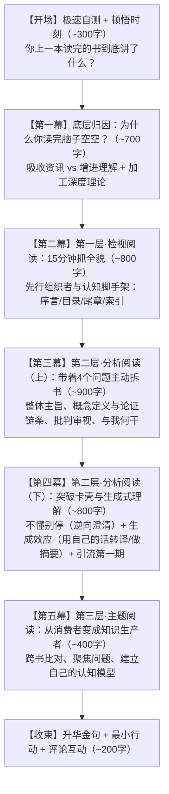

# 阶段 ⑤ · 写作大纲

> **选题**：为什么读完一本书脑子空空？——从《如何阅读一本书》提炼通用主动阅读体系  
> **目标字数**：4000+ 汉字（长影片深度逐字稿）  
> **风格基调**：理性的导师、全程说人话（剔除侦探/侦察兵/手术刀/录像机等花哨比喻）、科学硬核、微观场景具象化、极低门槛行动

---

## 总体架构设计

---

## 详细分幕大纲

### 一、 开场：极速自测与认知翻转（00:00 - 01:00，约 350 字）
1. **互动自测（前 15 秒入题，拒绝废话与痛点套路）**：
   - 直接抛出问题：“请你在心里快速回想一下：你上一本读完的书，能不能用一句话，说清楚它的核心观点是什么？”
   - 排除模糊答案：“不是书名，不是‘挺有启发的’，而是作者到底想解决什么问题？他的核心结论是什么？”
   - 去羞耻接纳：“如果你一下子答不上来，别慌，这绝不是你一个人会遇到的情况，绝大多数人合上书都是这个状态。”
2. **抛出核心认知翻转（顿悟时刻）**：
   - 问题的根源不在于你读得不认真，而是阅读这件事，从一开始就分两种：
     - **第一种：吸收资讯**。读完记住了几个名词、几条八卦或数据。这只是把信息暂存进了大脑的“临时缓存区”，过几个月缓存自动清理，什么都没留下。
     - **第二种：增进理解**。读完之后，你看待世界、分析问题的方式被彻底改变了——这是在给你的大脑“硬件升级”。
   - 亮出核心承诺：今天用 70 年经典《如何阅读一本书》的底层精髓，结合认知科学，彻底拆解一套通用的“主动阅读系统”，让你读过的每一本好书，都能真正升级你的思考硬件。

---

### 二、 底层归因：为什么逐字通读是“假阅读”？（约 750 字）
1. **反常识打假：学生思维的阅读毒素**：
   - 我们从小习惯了教科书式的阅读：从第 1 页第 1 行读到最后一页，生怕漏掉一个字。
   - 但成人的深度阅读从来不是逐字扫描。如果一本书你读起来完全顺畅、毫无阻力，你其实只是在已知信息的舒适圈里打转（吸收资讯）；只有读那些超出当前理解边界、读起来有点费劲的书，才有可能增进理解。
2. **科学锚点 1：加工深度理论（Levels of Processing）**：
   - 1972 年认知心理学家 Craik & Lockhart 的里程碑研究：大脑对信息的记忆与内化，根本不取决于你盯着它看了多久，而取决于你对它的**加工深度**。
   - **浅层加工**：眼睛按顺序扫过文字，大脑只处理文字符号和发音（眼动实验证实：走神时眼睛照常在动，但认知完全脱钩）。这就是为什么很多人“读完了整页，却不知道刚才看了什么”。
   - **深层加工**：对意义的语义加工、逻辑提问、概念关联与批判。
   - 引用 1975 年实验对比：同样记单词，只看字形（浅层）识别率只有 15%，而思考语义逻辑（深层）识别率高达 81%。
3. **推导行动逻辑**：
   - 想要增进理解，就必须停止被动的“扫字模式”，切换到“主动拆书模式”——也就是《如何阅读一本书》中最核心的两大实操：**检视阅读** 与 **分析阅读**。

---

### 三、 核心实操 1：检视阅读——15分钟给大脑搭“认知脚手架”（约 850 字）
1. **为什么绝大多数人死在第一章？**
   - 拿到一本新书，直接扎进第一章的细节，大脑由于缺乏全局地图，工作记忆（约 4 个信息块）瞬间过载，产生极大的心理阻力和疲惫感。
2. **科学锚点 2：认知脚手架（Cognitive Scaffolding）与先行组织者**：
   - 心理学家 Bruner 与 Ausubel 的研究：先建立高层级的宏观结构（先行组织者），大脑就预先搭建好了“认知挂钩（Slots）”。后续读到的零散论点、数据和案例，才能有条不紊地挂在对应的位置上。
3. **检视阅读 4 步极简实操（15–30 分钟抓全貌）**：
   - **第一步：看书名与序言/导读**：
     - 弄清作者的背景以及他“为何而写”。思想不会凭空产生，每一本书都在与它所处的时代背景对话（例如阿德勒反思一战，尼采批判传统道德）。搞清楚作者想要解决什么核心矛盾。
   - **第二步：研读目录**：
     - 目录是全书的骨架和思维地图。看作者是如何把一个大问题拆解成几个子维度的。
   - **第三步：直接翻看最后一章/结论**：
     - 大多数非虚构类书籍在尾章会收束核心推论与总结（如达尔文在《物种起源》尾章总结自然选择的边界）。先看结论，带着好奇心反推作者的论证过程。
   - **第四步：看索引与关键词**：
     - 快速扫一眼索引，了解全书高频出现的学者、概念与核心词汇。
4. **检视阅读的阶段产出**：
   - 花 15–20 分钟完成这一步，你不仅能精准判断这本书是否值得精读，而且已经在脑海里搭好了牢固的认知脚手架。

---

### 四、 核心实操 2：分析阅读（上）——带着 4 个问题拆解与对话（约 900 字）
1. **什么是真正意义上的精读（分析阅读）？**
   - 不再做被动接收者，而是把书本当作一场平等的智力对话。带着 4 个由浅入深的核心问题去读：
2. **问题 ①：整体来说，这本书到底在解决什么核心问题？**
   - 强制要求自己用一句话概括全书主旨。
   - 例如同是讲沟通，《非暴力沟通》核心在同理心与需求表达，而《关键对话》核心在高压冲突下的共识达成。切入点截然不同。
3. **问题 ②：作者详细说了什么？他是如何论证的？（关键概念与操作型定义）**
   - 厘清作者的关键术语。伏尔泰说：“如果你要跟我对话，请先定义好你的词汇。”
   - 寻找书中的“操作型定义”：同一个词在不同语境下含义完全不同（牛顿的重力 vs 爱因斯坦的引力）。
   - 抓出作者的核心论据链：他提出了什么前提？用了什么证据支撑？逻辑链条是否完整？
4. **问题 ③：这本书讲得全对吗？是全部有道理还是部分有道理？（理性批判）**
   - 破除权威迷信：作者也是人，也会有认知局限和时代局限。
   - 审视论证漏洞：是否存在以偏概全？前提假设是否成立？有没有忽略关键反例？（例如成功学常把“运气”和“时代红利”简化为个人努力）。
   - 真正的批判性思考：不盲从外在权威，依靠自身理性审视逻辑，同时清醒认识到任何理论的适用边界。
5. **问题 ④：这本书跟我有什么具体关系？（知识迁移）**
   - 如果一本书对你的行动没有产生任何影响，它就依然只是身外之物。
   - 提问自己：“这个原理能解释我生活/工作中的什么卡点？我明天可以根据它做出什么微小调整？”

---

### 五、 核心实操 3：分析阅读（下）——突破卡壳与生成式内化（约 850 字）
1. **破解阅读卡壳：遇到不懂的地方，千万不要停下来！**
   - **反直觉原则**：很多人的阅读习惯是一个字不懂就卡在那查资料、反复死磕，结果把上下文的语流彻底打断。
   - **认知科学机制（Kintsch 构建-整合模型）**：高效阅读者懂得“容忍局部模糊”。第一遍一口气通读，让大脑先掌握全局上下文；随着后文内容的展开，已理解的宏观背景会自动反向澄清前面模糊的概念。先读完一遍，再带着针对性回头攻克重点。
2. **科学锚点 3：生成效应（Generation Effect）——说得出来，才叫真懂**
   - 1978 年 Slamecka & Graf 及其后续研究（Doctorow 等 1978, Chi 1994）：被动重读的记忆效果极其微弱；而只要让学习者合上书、用自己的话写一句摘要或解释给别人听，理解深度和记忆留存直接提升 50% 到 100%。
   - **实操抓手：从大纲到摘要转译**：
     - 读完一个章节，合上书，尝试做这件事：能否把两千字的核心内容，用自己的话浓缩成 100 字？
     - 检验两个致命卡点：第一是是否真的理解了核心（没有抓错重点），第二是能否用自己的词汇精准转译出来（而不是照搬作者的原话或滥用过度形容词）。
3. **自然引流第一期**：
   - 读完之后如何进一步用输出倒逼输入？如何利用费曼技巧和提取练习把知识死死焊进脑子里？我们在半年前的第 1 期读书视频《简单 3 步吃透 1 本书》里有专门的落地拆解，想要系统建立输出习惯的朋友可以回看那期。

---

### 六、 高维进阶：主题阅读——成为知识的生产者（约 400 字）
1. **从“读一本书”升级到“攻克一个主题”**：
   - 当你面临一个复杂的现实议题（如精力管理、商业决策、育儿认知），单一一本书的观点往往带有作者的片面视角。
2. **主题阅读的核心逻辑（说明白即可，不搞复杂流程）**：
   - **不被任何单一一本书牵着鼻子走**：你才是研究的主人，书只是你的参考资料。
   - **围绕同一个核心问题找答案**：列出你要解决的疑问，同时翻阅 3–5 本相关领域的经典。
   - **比对共识与分歧**：找出不同作者在哪里达成了一致，在哪里产生了激烈冲突。冲突和分歧的地方，往往就是该领域最深层、最有价值的认知本质。
   - 最终拼出属于你自己的认知全景图，完成从“知识消费者”到“知识生产者”的蜕变。

---

### 七、 升华收束与行动指引（约 250 字）
1. **克制而有力量的升华**：
   - 读书从来不是为了在书架上炫耀读了多少本，也不是为了在脑子里堆砌一堆没用的名词碎片。
   - 真正的阅读，是一场平等的思想对话；每一本被你真正读懂的好书，都在悄悄重构你的思考操作系统。
2. **今日最小微行动**：
   - 今天不要贪多，就挑手边一本你想读但一直没读完的书：
   - 按照今天讲的方法，花 15 分钟做一次检视阅读——看序言、扫目录、翻结论，然后合上书，尝试用一两句话把它的核心问题说出来。
3. **互动引导**：
   - 你过去读书最大的卡点是什么？是读不下去，还是读完就忘？在评论区留下你的经历，我们一起讨论。

---

## 4000字篇幅承重与细节填充规划

| 模块 | 预估字数 | 核心承重与细节展开要点 |
|---|---|---|
| **开场与自测** | ~350 字 | 3秒入题自测、去羞耻接纳、吸收资讯 vs 增进理解（缓存 vs 升级）核心定义 |
| **底层归因** | ~750 字 | 学生思维打假、加工深度理论（Craik 1972/1975 实验细节 15% vs 81%）、走神阅读眼动脱钩现象 |
| **检视阅读** | ~850 字 | 认知负荷与脚手架原理、先行组织者、4步实操细节（序言时代背景/目录思维地图/尾章结论/索引） |
| **分析阅读（上）** | ~900 字 | 4个核心问题逐层展开、伏尔泰操作型定义（牛顿与爱因斯坦对比）、批判性思维（康德式不盲从权威与边界识别） |
| **分析阅读（下）** | ~850 字 | 遇到不懂别停（Kintsch 逆向澄清模型）、生成效应（Slamecka 1978 & Doctorow 摘要实验）、转译卡点与第一期引流 |
| **主题阅读** | ~400 字 | 主人视角 vs 奴隶视角、跨书比对共识与冲突、构建个人认知模型 |
| **收束升华** | ~250 字 | 金句升华、15分钟最小行动落地、互动提问 |
| **合计** | **~4350 字** | 结构严密，理论与实操兼备，完全撑得住 4000+ 汉字长视频 |
