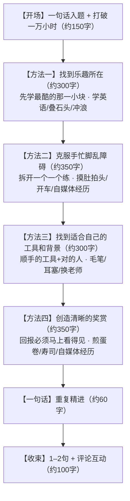

# 阶段 ⑤ · 写作大纲

> **选题**：微精通——快速学会任何技能的四个方法
> **目标字数**：1500–1800 汉字（中短影片）
> **风格基调**：大白话破圈，不掉书袋。三个术语各一句话解释且不用比喻。不做痛点共鸣、不做去羞耻归因，一句话开门见山。对两本原始来源的作者不做赘述。
> **结构变体说明**：不采用基础六段模板。本期为「四方法并列递进式」——开场一句话入题，四个方法依次展开（每个方法 = 一句原理 + 一个通用例子 + 一个可做的动作），末尾一句话带过重复精进，收束 1–2 句。理由：中短影片体量装不下痛点段+归因段+深化段，且方法本身足够直白，观众要的是"具体怎么做"，不是"为什么我学不会"。

---

## 总体架构

---

## 详细分段大纲

### 一、开场：一句话入题（约 150 字）

1. **第一句直接给结论**，不铺垫、不共情：
   - "学会一件事，根本不需要一万小时。你只需要学会它其中最小、最完整的那一块。"
2. **一句话拆掉一万小时的心理壁垒**：
   - 一万小时说的是成为世界级高手要多久，不是"上手"要多久。绝大多数人卡住的地方，是不敢开始，不是练得不够。
3. **抛出核心承诺**：
   - 今天讲四个方法。用完这四个，你想学的任何一件小事，都能在几天内做出一个能拿给别人看的成果。

> **写作提醒**：开场不出现任何术语，不出现书名作者的介绍性铺陈（提到出处即可）。

---

### 二、方法一：找到乐趣所在（约 300 字）

1. **核心主张**：别从基础练起，从最酷的那一小块开始。
2. **通用例子（保留，主推）· 学英语**：
   - 传统路径：从音标、语法、词汇表开始，背到第三页就放弃。
   - 换个入口：只拿下最高频的那一小批词。英语里高频词的分布极不均匀，最常用的一千个词族就能覆盖日常口语的大约八成内容。先吃下这一批，你立刻能听懂大半日常对话。
   - 关键差别：前者要三个月才有感觉，后者两周就能有"我居然听懂了"的瞬间。
3. **通用例子（保留，短带）· 叠石头 + 冲浪**：
   - 叠石头：找一块表面有三个凸起的石头，三个点构成稳定三角，另一块石头放上去就稳。一个物理小把戏，几分钟就能叠出让人惊讶的造型。
   - 冲浪：第一步根本不用下水。趴在客厅地板上，练从俯卧到站起的那一下。地板上没有浪、没有恐惧，身体先把这个动作记住。
4. **行动**：
   - 挑你想学的那件事，找出它"最酷、最快能看到成果"的那一小块，从那里下手。
5. **原理连接（一句话，不用比喻）**：
   - 成年人的大脑不会因为年龄停止改变，只要在学新东西，神经连接就会重新组织。真正的门槛不是年龄，是有没有开始。

> **术语控制**：本段只出现"神经可塑性"的白话版，不出现术语本身。

---

### 三、方法二：克服"手忙脚乱障碍"（约 350 字）

1. **命名与定义**：
   - 用一个人人试过的游戏定义它：一只手揉肚子，一只手拍头，同时来。第一次几乎做不到。
   - 学任何新技能都有这样一个卡点：两个动作单独都会，一起上就乱。
2. **通用例子（保留）· 开车**：
   - 看后视镜、控离合、打方向、判断车距，每一件单独都不难，同时来就手脚打结。老司机不是脑子快，是每一个动作都已经不用想了。
3. **自媒体经历（用户口述，第 1 次出现）**：
   - 一年前开始做 YouTube，三件全新的事同时压过来：写文稿，一个开场引言要想两三天，写了删，删了写；调音，连该用哪个软件都不知道；剪辑，完全不知道从哪里下手。
   - 落点：不是能力不行。是三个动作都还没变成不用想就会做的事，它们在互相抢注意力。
4. **原理连接（一句话，不用比喻）**：
   - 一个动作还得靠脑子专门盯着的时候，就会占掉注意力；两个都得盯着，就一定互相干扰。
   - 补充数据点（可选）：人同时能主动持有的信息单元只有四个左右，新技能的每个子动作都要占一个位置。
5. **行动**：
   - 把这件事拆成几个子动作，先只练一个，练到不用想。再加第二个。
   - 障碍与应对：会觉得慢。但把一个练到自动化之后，注意力被释放出来，第二个学得比第一个快。
6. **克制声明**：
   - 不主张"拆开练永远更好"，只主张"两个都没自动化的动作同时练一定互相干扰"。（资料卡片标为证据不一致）

---

### 四、方法三：找到适合自己的工具和背景（约 300 字）

1. **核心主张**：工具不用贵，但必须顺手到你想去碰它。环境和人同样算工具。
2. **通用例子（保留）· 画圆 + 自由潜 + 换老师**：
   - 画禅意圆圈：换一支笔尖顺滑的毛笔，一笔画下去的手感会直接反过来提高稳定度。工具改变的不只是结果，是你还想不想再画一次。
   - 自由潜：一副防水耳塞解决了下潜时耳压平衡的问题。一个几十块的小东西，解决的是让人放弃的那个点。
   - 换老师：有人学吉他快放弃了，换了一个更合得来的老师，兴趣又回来了。老师不一定是高手，只要能让你愿意多练一会儿。
3. **行动**：
   - 两件事：一是把工具挑到你顺手，二是把它放在手边、提前摆好。
   - 想做的事只要多一道小手续，人就会放弃；启动成本降到极低，行为才会真的发生。
4. **原理连接（一句话，不用比喻）**：
   - 人的动力来自三件事：自己能做主、觉得自己做得到、身边有人一起。自己挑工具满足第一件，顺手的工具满足第二件，找到合适的人满足第三件。

> **写作提醒**：这段最容易写成器材推荐，必须收在"让你想再来一次"这个判断标准上。

---

### 五、方法四：创造"清晰的奖赏"（约 350 字）

1. **核心主张**：只学那些能马上看到回报的东西。回报越早，越撑得住。
2. **通用例子（保留）· 煎蛋卷 + 寿司**：
   - 煎蛋卷：一个周末就能练出边缘焦脆、内心流心的一份。奖赏是当场吃掉它，或者端给别人看他的表情。
   - 寿司：学会基础之后，端上桌那一刻的赞叹就是回报。
   - 反面对照：把回报押在"三年后能用这门外语流利对话"，中间三年没有任何东西撑着你。
3. **自媒体经历（用户口述，第 2 次出现）**：
   - 按递进顺序讲：第一次完整发出一支片子；第一个点赞；第一个订阅；第一条陌生人留言说"这个对我有用"。
   - 落点：这四件事，没有一件改变了生活。但从那之后，第二支片子的启动成本明显变低了。
4. **原理连接（一句话，不用比喻）**：
   - 大脑在结果好于预期时会释放多巴胺，这个信号会推着你想再来一次。
   - 补充：同样的奖赏，放在过程中立刻给，比放到结束后再给更能维持动力。
5. **行动**：
   - 给你想学的这件事，设一个"今天就能拿给别人看"的成果。做不出来就把它再切小一点。

> **写作提醒**：自媒体这段两三句话交代完，不诉苦、不加时间线、不加数据。

---

### 六、一句话带过：重复精进（约 60 字）

- 剩下的事只有一件：把这一小块重复做。每做一次，你都能看到自己比上次好一点，这就够了。
- 反复练同一件具体的事，大脑对应的区域会真的发生改变——有研究给一批成年人从零学三球抛接，练了三个月，大脑相关区域的灰质可测量地增大了。

---

### 七、收束（约 100 字）

1. **1–2 句收束，克制，不升华成鸡汤**：
   - "你不需要一万小时。你需要的是一个今晚就能做完、并且能拿给别人看的小东西。"
   - "从小处开始，但立刻开始。"
2. **评论互动**：
   - "你最近想学什么？把它砍到只剩最小的一块，然后告诉我那一块是什么。"

---

## 写作校验清单（撰稿前对照）

- [ ] 全片字数 1500–1800，不超 2000
- [ ] 开场第一句就是结论，没有痛点共鸣段、没有去羞耻归因段
- [ ] 三个科学锚点各只用一句白话解释，且不含比喻
- [ ] 每段新术语不超过 2 个；能不出现术语本身就不出现
- [ ] 自媒体经历出现两次（方法二、方法四），两处原有通用例子全部保留
- [ ] 不出现"75%""65%"等待验证数字；覆盖率只说"大约八成"
- [ ] 不出现"其实""事实上"假转折；不出现"记住""一定要"命令句
- [ ] 平均句长 15–20 字，不超 30 字
- [ ] 对两本原始来源的作者不做赘述，参考资料在片尾列出
- [ ] 收束 1–2 句，不做长篇升华
